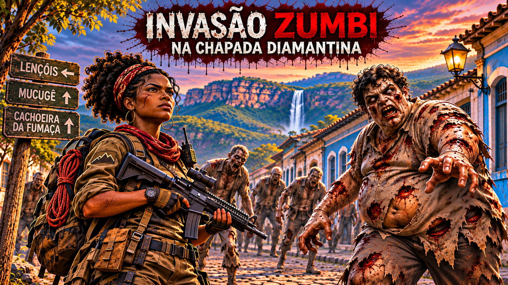

# Invasão Zumbi na Chapada Diamantina

Game developed for the **Game Programming** course. Created using the Unity Engine (version `6000.0.84f1`) and published on Unity Play.

> **Advisor:** Murilo Boratto  
> **Created by:** Levi and JP (A.K.A. João Pedro Lobo Oliveira)

Play the game clicking [here](https://www.youtube.com/watch?v=dQw4w9WgXcQ)

### 📚 Referência

[Zombie Rural — Vídeo de referência](https://www.youtube.com/watch?v=vqDu9_FdA0A&t=29s)

### 🔊 SoundEffect
[Helicopter Sound Effect](https://youtu.be/2RtDgTm6rn4?si=iCHgYHJ_AiJCN17b)

### 🎵 Music
[Devil May Cry: Dante's theme Lock and Load](https://youtu.be/J7I0gFm4lqI?si=_yja23jnBXX_T4YN)
